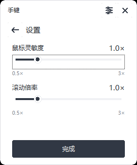

# 手键 · 纯 C 版（Win32 / GDI，无 WebView）

手机扫描主窗口显示的二维码，然后在手机网页上通过 WebSocket 控制 PC 键鼠，支持横屏和竖屏。

这是 `code/`（Tauri 2 + WebView2）版本的 **纯 C 重写**，放在 `c_version/` 下，与原有实现完全独立：

- **紧凑主窗口**：启动后显示 282×338 逻辑像素的二维码窗口，右上角提供设置和关闭图标。关闭后继续在托盘运行。
- **没有 WebView**：二维码由 GDI 直接逐模块画进位图，PC 端不加载任何浏览器内核，也不依赖 WebView2 Runtime。
- 手机网页（`controller.html/css/js`）仍是浏览器页面，由内置 HTTP 服务提供。




## 构建

需要 Visual Studio 2022 Build Tools（MSVC + Windows SDK，`vcvars64.bat` 存在即可）。

```powershell
.\build.ps1
```

产物：`release\PhoneKeyboardC.exe`（单文件，免安装）。

构建脚本会：

1. `tools\embed.ps1` 把 `web\controller.*` 转成 `build\web_assets.h`（字节数组）；
2. 调用 `rc.exe` 编译 `res\app.rc`（图标 + manifest）；
3. 用 `cl.exe` 编译 `src\*.c` 并链接为 GUI 子系统程序。

## 使用

1. 运行 `PhoneKeyboardC.exe`，显示「手键」主窗口，同时添加托盘图标。
2. 窗口不再随鼠标悬停出现或消失，可拖动顶部标题区域移动位置。
3. 手机连同一个局域网，扫码打开控制页面。
4. 手机端：单指滑动移动鼠标、轻点左键、双指轻点右键、双指滑动滚轮；稳定长按约 450 毫秒后滑动，按住左键拖动，抬手松开。
5. 右上角设置图标打开倍率滑条；关闭图标隐藏窗口，托盘继续运行。单击托盘图标或再次运行程序可重新打开。
6. 托盘菜单（右键）：打开主界面 / 重新生成二维码 / 复制链接 / 退出。

设置页分别提供鼠标灵敏度、滚动倍率两个滑条，范围 `0.5×～3.0×`，步长 `0.1×`，数值显示一位小数。拖动时立即作用于已连接的手机，鼠标灵敏度也适用于长按拖拽；松手、键盘调整结束、离开设置页或关闭窗口时保存。设置仍保存在当前 Windows 用户的 `HKCU\Software\PhoneKeyboardC` 下，重启后恢复，不改变系统鼠标设置。旧版 `0.75×`、`1.25×` 分别按最近的新档位恢复为 `0.8×`、`1.3×`。

交互细节：

| 操作 | 行为 |
| --- | --- |
| 悬停或移开托盘图标 | 不改变主窗口的显示状态 |
| 左键单击托盘图标 | 打开已有主窗口并置于前台 |
| 关闭图标 / Alt+F4 | 隐藏主窗口，手机连接和托盘继续运行 |
| 拖动顶部标题区域 | 移动窗口，连接状态变化时不重置位置 |
| 设置图标 | 打开倍率滑条；返回图标或「完成」回到二维码页 |
| 右键单击托盘图标 | 打开菜单 |
| 手机连上/断开 | 二维码下方的连接提示更新，窗口不抢占焦点 |
| 拖动键盘和触控板之间的细条 | 向左：全键盘 → 同屏 → 全鼠标；向右反向切换，每次切换一档 |
| 长按触控板后滑动 | 光标在窗口边缘时调整尺寸，在标题栏时移动窗口，在文字或文件区域时拖选；抬手结束 |
| Shift / Ctrl / Alt / Win | 选中下一次按键或鼠标操作的修饰键，操作完成后释放 |
| Caps Lock | 独立切换大写锁定；与 Shift 同时选中时临时小写 |
| 中/英 | 按钮固定显示「中/英」；向电脑发送一次独立的 Shift 点击，使用电脑输入法已有的中英切换行为 |
| 123 / abc | 切换字母与数字符号；两层均保留 F1–F12、Shift 和 Caps Lock |

三个模式采用同一套原型键位，不再显示旧版 104 键面板。横屏同屏时键盘与触控板约为 7:3；窄竖屏上下排列，较短屏幕可滚动查看。拖条的操作区为 18px（触屏 24px），按下和拖动只改变细条颜色。

长按前移动超过 6px 会立即进入普通鼠标移动；长按触发前的小幅抖动不会移动电脑光标。拖拽中加入第二根手指会先松开左键，该次手势不再触发点击或滚动。切换模式、触摸取消、失焦或切后台也会释放输入。

## 命令行参数

正常使用不需要任何参数；以下开关用于自动化验证与排查。

| 参数 | 说明 |
| --- | --- |
| `--port <n>` | 固定监听端口（默认随机空闲端口） |
| `--token <32位hex>` | 固定配对令牌（默认每次启动随机生成） |
| `--log <file>` | 追加诊断日志（UTF-8） |
| `--state-file <file>` | 原子写出托盘矩形、窗口可见状态、设置页状态和倍率（测试用） |
| `--preview <ms>` | 兼容旧参数：启动时显示主窗口，不再按毫秒数自动隐藏 |
| `--render-card <bmp>` | 离屏渲染主窗口为 BMP 后退出（不联网、不建托盘） |
| `--qr-dump <txt>` | 导出二维码模块矩阵后退出（用于交叉校验） |
| `--no-tray` | 不创建托盘图标且默认不显示窗口（测试用）；配合 `--preview` 显示时，关闭窗口会退出 |
| `--dry-run` | 只跑协议，不注入任何键鼠 |
| `--quit-after <ms>` | 定时退出 |
| `--allow-multi` | 跳过单实例限制 |

## 代码结构

```text
src/app.h        共享类型、常量、模块接口
src/main.c       入口、托盘图标、菜单、倍率持久化、命令行
src/card.c       GDI 主窗口、图标按钮、原生滑条、DPI 适配
src/qrcodegen.c  Nayuki QR Code 生成库（MIT，见下方许可）
src/server.c     HTTP + WebSocket 服务、令牌、单控制端管理
src/input.c      SendInput 键鼠注入、按键表
src/motion.c     鼠标移动平滑（4ms 步进 / 16ms 窗口）
src/net.c        局域网 IPv4 选择
src/sha1.c       SHA-1 + Base64（WebSocket 握手用）
src/util.c       日志、UTF-8 转换、令牌、JSON 取值
res/             图标、manifest、资源脚本
web/             手机端页面（原型布局、键盘状态、模式拖条与长按拖拽）
tools/embed.ps1  资源内嵌脚本
```

要点：

- 主窗口使用普通 Win32 弹出窗口、GDI 双缓冲绘制和原生按钮/Trackbar，不置顶、不穿透鼠标。滑条依赖 Windows 自带的 `comctl32.dll`，不增加第三方运行时。
- 二维码在 230×230 逻辑像素的区域内按整数像素放大并保留静区，不做插值。
- 窗口每显示器 DPI 感知，首次按托盘所在显示器的工作区定位，任务栏在顶部时自动翻到下方；之后保留用户拖动的位置。
- 键鼠注入与移动平滑都在同一个临界区内完成，保证「先移动再点击」的顺序。

## 验证

```powershell
.\tests\protocol-test.ps1   # HTTP/WebSocket 协议、令牌、CSP
.\tests\keymap-test.ps1     # 与 code/src-tauri/src/input.rs 的 104 个按键逐项比对
.\tests\input-state-test.ps1 # 注入替身：拖拽、倍率、小位移累积、限幅、失败清理与重试
node --test .\tests\controller-test.js # 无依赖：前端手势、键位和 WebSocket 发送顺序
.\tests\hover-state-test.ps1 # 原生控件与托盘：打开/关闭、滑条、旧配置迁移、保存失败、DPI
.\tests\hover-test.ps1      # 真实进程：启动显示、图标按钮、托盘重开、关闭后 HTTP 服务
```

先运行构建，再运行上述测试。前端测试只需 Node.js；输入状态测试替换 `SendInput` 和移动模块。两个 `hover` 测试保留历史文件名，但现在验证主窗口行为：状态测试对隐藏的原生控件发送消息，使用注册表替身；进程测试启动 `--dry-run` 测试实例并发送窗口/托盘消息，不移动真实光标、不修改真实倍率，结束后退出测试实例并清理测试文件。进程测试的 `-Executable` 可指定待验证程序，`-SnapshotDir` 可保存实际窗口截图。

二维码另外与 Rust `qrcodegen 1.8` 做过矩阵级交叉校验：同一 URL 下 33×33 模块 0 处差异（`--qr-dump` 输出与参考实现逐行比较）。

## 与原实现的差异

| | `code/`（Tauri） | `c_version/`（纯 C） |
| --- | --- | --- |
| 二维码位置 | 440×520 主窗口 | 282×338 主窗口，关闭后托盘运行 |
| 渲染 | WebView2 + SVG | GDI 直接画位图 |
| 运行时依赖 | 需要 WebView2 Runtime | 无（只用系统 DLL） |
| 体积 | 2.85 MB | 本次 MSVC 构建约 144.5 KB |
| 托盘菜单 | 显示 / 重新生成 / 退出 | 打开主界面 / 重新生成 / 复制链接 / 退出 |

`code/` 下的文件没有被修改。

## 已知边界

- 只支持 Windows（Win10/11 实测）。
- 窗口尺寸按 Windows 显示缩放比例放大；首次位置靠近托盘，可拖动标题区域调整。
- 登录界面、UAC 提权窗口收不到普通 `SendInput`。
- 未实现按键长按连发；触控板已支持长按拖拽。
- 中/英按钮固定显示文字，按 PC 输入法的 Shift 切换设置工作，不切换输入法程序。标点显示与 Caps Lock 高亮记录手机端操作，不读取电脑状态；电脑端手动切换或重新加载页面后可能不同步。
- 设置页倍率在 PC 端处理，兼容现有手机输入协议；滚动倍率调整每次滚轮输入的距离，手机端首次累积到一个滚轮刻度的触发距离仍由前端基准决定。
- 数字符号按标准美式键位发送物理键与 Shift；中文标点由 PC 当前输入法处理。
- 检测到断连后会释放输入；网络无声中断仍依赖现有心跳（Pong 超时 45 秒），不能保证立即松开。
- 首次监听局域网时 Windows 防火墙会询问，需要允许专用网络入站。

## 许可

`src/qrcodegen.c` / `src/qrcodegen.h` 来自 [Project Nayuki 的 QR Code generator](https://www.nayuki.io/page/qr-code-generator-library)（MIT License），文件头保留了原始版权声明。
